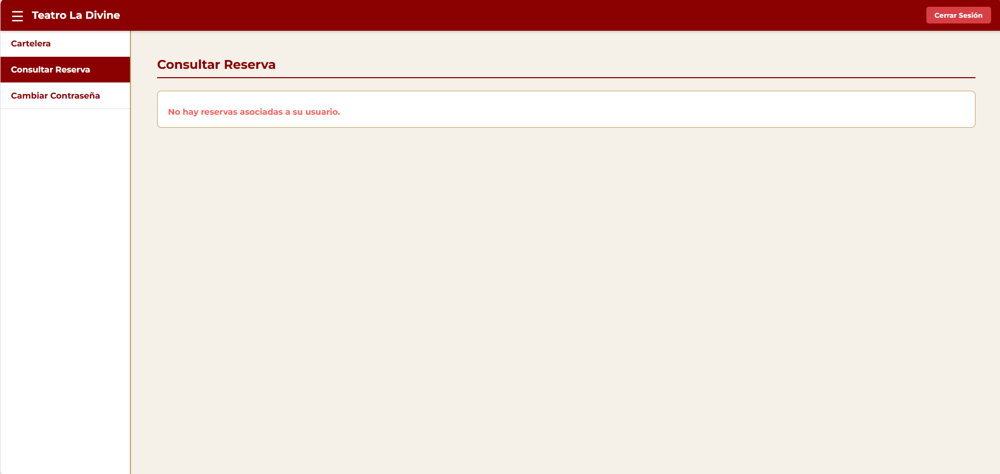
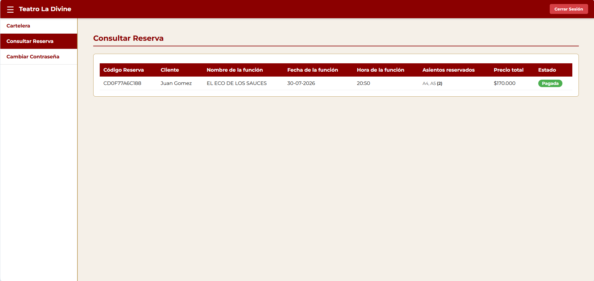
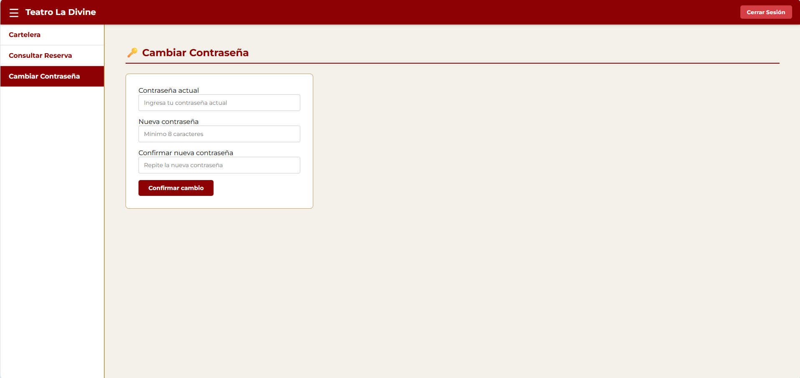
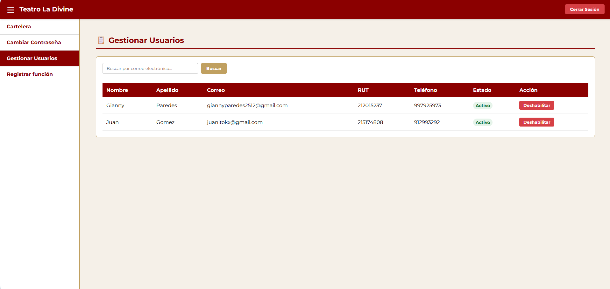
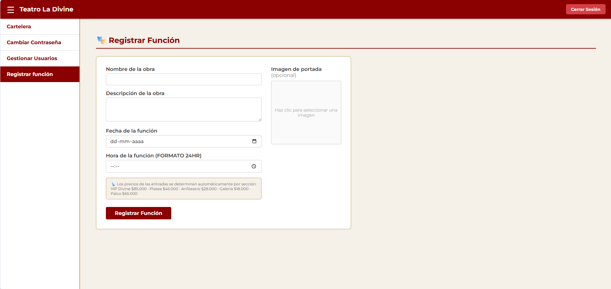

# 🎭 FRONTEND - Sistema Web Teatro La Divine

## 📌 Descripción del proyecto

Interfaz de usuario (SPA) para el sistema de gestión del Teatro La Divine. Este módulo permite a clientes y administradores interactuar con la plataforma: iniciar sesión, registrarse, consultar la cartelera, reservar entradas, gestionar reservas y administrar usuarios.

Proyecto desarrollado en el contexto de la asignatura **Ingeniería de Software**.

---

## ⚙️ Cómo ejecutar el proyecto

1. Abre una terminal y posiciónate dentro de la carpeta `frontend`.
2. Crea un archivo `.env` en la raíz del proyecto con la siguiente variable:

```
VITE_API_URL=http://localhost:5000/api
```

> ⚠️ Asegúrate de que el backend esté levantado y corriendo en el puerto indicado antes de iniciar el frontend.

3. Instala las dependencias de Node.js:
```
npm install
```

4. Levanta el servidor de desarrollo de Vite:
```
npm run dev
```

5. Abre tu navegador en la ruta que indique la consola (usualmente `http://localhost:5173`).

---

## 🗺️ Rutas de la aplicación

| Ruta | Acceso | Componente | Descripción |
| :--- | :--- | :--- | :--- |
| `/` | Público | `Login` | Redirige al login |
| `/login` | Público | `Login` | Inicio de sesión |
| `/register` | Público | `Register` | Registro de nuevo cliente |
| `/dashboard/*` | Protegido | `Dashboard` | Panel principal (Admin y Cliente) |

> Las rutas públicas redirigen al dashboard si el usuario ya tiene sesión activa (`PublicRoute`).
> Las rutas protegidas redirigen al login si no hay sesión activa (`ProtectedRoute`).

---

## 👑 Funcionalidades implementadas (Iteración 1)

### Administrador
* **Gestión de Cuentas:** Visualización de todos los usuarios del sistema en una tabla dinámica (`UserManagement.tsx`).
* **Búsqueda por Correo:** Herramienta para buscar cuentas específicas. Si el correo no existe, se despliega el mensaje correspondiente de la ERS.
* **Habilitar y Deshabilitar:** Control de acceso de usuarios clientes. Los usuarios deshabilitados rebotan en el Login.
* **Doble Confirmación:** Modal de seguridad (`ConfirmModal.tsx`) para evitar cambios de estado accidentales.

### Usuario (Admin y Cliente)
* **Cambiar Contraseña:** Formulario para actualizar la contraseña del usuario autenticado (`ChangePassword.tsx`).

---

## 🎟️ Funcionalidades implementadas (Iteración 2)

### Administrador
* **Registrar Función (FUN-001):** Formulario para crear nuevas funciones en la cartelera con nombre, descripción, fecha/hora e imagen de portada opcional (`RegisterFunction.tsx`).

### Cliente
* **Consultar Cartelera (FUN-002):** Listado de funciones vigentes con filtro por nombre y fecha (`Billboard.tsx`). Consume `BillboardServices.ts`.
* **Reservar Entrada (FUN-003):** Mapa interactivo de asientos con diferenciación visual por estado y sección (`SeatMap.tsx`). Consume `ReservationService.ts`.
* **Consultar Reservas (FUN-004):** Historial de reservas del usuario autenticado con estado y detalle de asientos (`MyReservations.tsx`).

---

## 🏗️ Tecnologías y Estructura

* **Librería principal:** React
* **Lenguaje:** TypeScript (.tsx / .ts)
* **Empaquetador:** Vite
* **Estilos:** CSS Puro (Módulos / Variables globales)
* **Enrutamiento:** React Router DOM

Estructura de carpetas:

```
frontend/
│
├── public/                  # Assets estáticos, favicon e imágenes de vista previa
├── src/
│   ├── assets/              # Imágenes y SVGs locales (ej: Logo)
│   ├── components/          # Componentes de la aplicación
│   │   ├── Billboard.tsx        # Cartelera de funciones (FUN-002)
│   │   ├── ChangePassword.tsx   # Cambio de contraseña (USU-004)
│   │   ├── ConfirmModal.tsx     # Modal de doble confirmación
│   │   ├── Dashboard.tsx        # Panel principal con subrutas
│   │   ├── Login.tsx            # Inicio de sesión (USU-001)
│   │   ├── MyReservations.tsx   # Historial de reservas (FUN-004)
│   │   ├── ProtectedRoute.tsx   # Guard para rutas privadas
│   │   ├── PublicRoute.tsx      # Guard para rutas públicas
│   │   ├── Register.tsx         # Registro de cliente (USU-002)
│   │   ├── RegisterFunction.tsx # Registro de función (FUN-001)
│   │   ├── SeatMap.tsx          # Mapa de asientos (FUN-003)
│   │   └── UserManagement.tsx   # Gestión de usuarios (USU-003)
│   ├── config/
│   │   └── config.ts            # URL base de la API
│   ├── interfaces/
│   │   └── Login.types.ts       # Tipos e interfaces TypeScript
│   ├── services/                # Consumo de la API del backend
│   │   ├── api.ts               # Instancia base (axios / fetch)
│   │   ├── AuthServices.ts      # Login, registro, cambio de contraseña
│   │   ├── BillboardServices.ts # Consulta de cartelera
│   │   ├── FunctionServices.ts  # Registro de funciones
│   │   └── ReservationService.ts# Asientos y reservas
│   ├── styles/                  # Archivos CSS por sección
│   │   ├── dashboard.css
│   │   ├── login.css
│   │   └── register.css
│   ├── App.tsx                  # Enrutador principal y rutas protegidas
│   ├── App.css
│   ├── main.tsx                 # Punto de entrada
│   ├── index.css                # Variables y estilos base
│   └── vite-env.d.ts
└── package.json                 # Dependencias y scripts
```

---

## 🎨 Estándares de interfaz (UI)

Se utilizan los colores definidos en los requerimientos para mantener la identidad y estética del teatro:

* Primario: `#8B0000`
* Secundario: `#C0A060`
* Crítico: `#D64045`
* Advertencia: `#E6C229`
* Acento: `#F5F0E8`

Ejemplo de uso en CSS:

```css
:root {
  --primario: #8B0000;
  --secundario: #C0A060;
  --critico: #D64045;
  --advertencia: #E6C229;
  --acento: #F5F0E8;
}
```

---

## 💻 Estándares de programación

### 🔹 Idioma
* **Código Fuente:** En **Inglés** (componentes, hooks, variables, rutas).
  > ⚠️ Se reconoce que existen algunos deslices puntuales en español dentro del código fuente (principalmente en nombres de funciones y variables de servicios), los cuales no afectan el funcionamiento del sistema y serán corregidos en futuras iteraciones.
* **Documentación:** El README.md, documentación y comentarios en **Español**.

### 🔹 Nombres
* Componentes React e Interfaces TS: PascalCase
* Funciones, variables y estados: camelCase

---

## 🧪 Casos de prueba Frontend

| Caso | Entrada / Acción | Resultado esperado |
| :--- | :--- | :--- |
| Email inválido | Ingresar formato erróneo en Login | Borde rojo (#D64045) y mensaje de error |
| Búsqueda vacía | Buscar un correo que no existe en BD | Mensaje de error en color #f56558 |
| Deshabilitar usuario | Clic en botón Deshabilitar en tabla | Apertura del Modal de confirmación |
| Redirección sin sesión | Entrar a /dashboard sin iniciar sesión | Redirección forzada a /login |
| Redirección con sesión | Entrar a /login con sesión activa | Redirección forzada a /dashboard |
| Fecha inválida en función | Ingresar fecha anterior a la actual (FUN-001) | Mensaje de error en color #f56558 |
| Sin funciones disponibles | Cargar cartelera sin funciones vigentes (FUN-002) | Mensaje: "No hay funciones disponibles en este momento" |
| Filtro sin resultados | Filtrar cartelera sin coincidencias (FUN-002) | Mensaje: "No se encontraron funciones con los criterios indicados" |
| Asiento no disponible | Intentar seleccionar asiento ocupado (FUN-003) | Mensaje: "El asiento seleccionado no se encuentra disponible" |
| Sin reservas | Consultar reservas sin historial (FUN-004) | Mensaje: "No hay reservas asociadas a su usuario" |

---

## 🖼️ Vista Previa del Sistema

<p align="center">
  
  <br>
  <em>Figura 1: Iniciar sesión.</em>
</p>

<p align="center">
  
  <br>
  <em>Figura 2: Registrarse.</em>
</p>

<p align="center">
  
  <br>
  <em>Figura 3: Página principal del sistema.</em>
</p>

<p align="center">
  
  <br>
  <em>Figura 4: Sección donde el usuario puede ver sus reservas hechas (Caso: Ninguna reserva hecha).</em>
</p>

<p align="center">
  
  <br>
  <em>Figura 5: Sección donde el usuario puede ver sus reservas hechas.</em>
</p>

<p align="center">
  
  <br>
  <em>Figura 6: Sección donde el usuario logueado puede cambiar su contraseña.</em>
</p>

## 👥 Funcionalidades de ADMIN

<p align="center">
  
  <br>
  <em>Figura 7: Vista de gestión de usuarios del administrador.</em>
</p>

<p align="center">
  
  <br>
  <em>Figura 5: Vista de regitro de funciones para el sistema.</em>
</p>

---

## 👥 Integrantes

* Martín Alejandro Solari Garrido
* Daniel Antonio Días Vargas
* Gianny Alfredo Paredes Araya
* Juan José Gómez Vergara

---

## 📌 Estado del proyecto
✅ **Iteración 1 Finalizada** – Autenticación, registro y gestión de usuarios implementados.  
✅ **Iteración 2 Finalizada** – Cartelera, mapa de asientos, reserva y consulta de reservas integrados.
