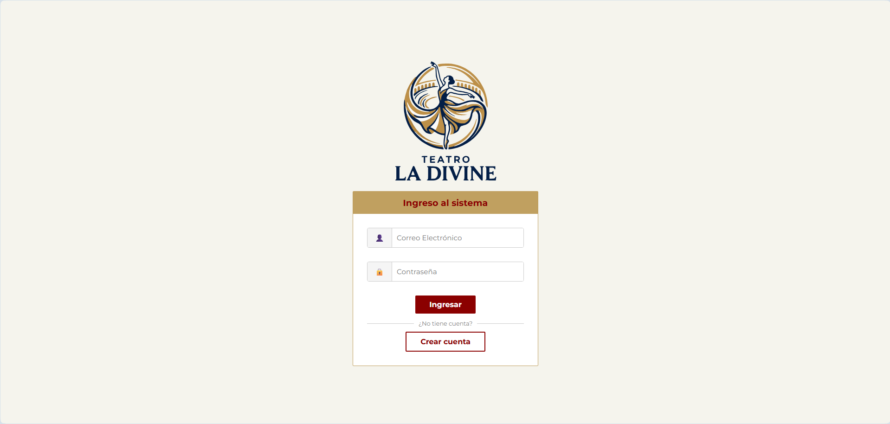
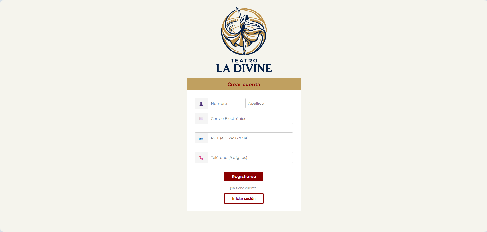
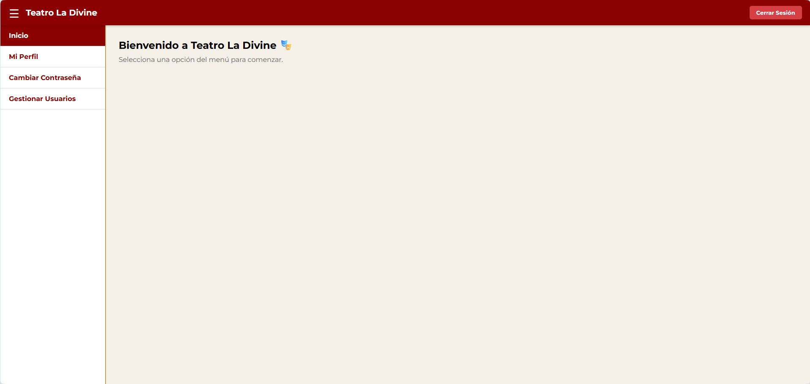
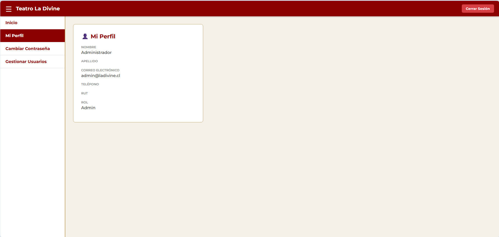
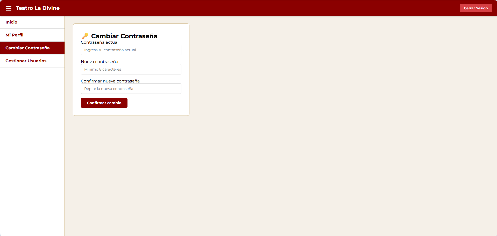
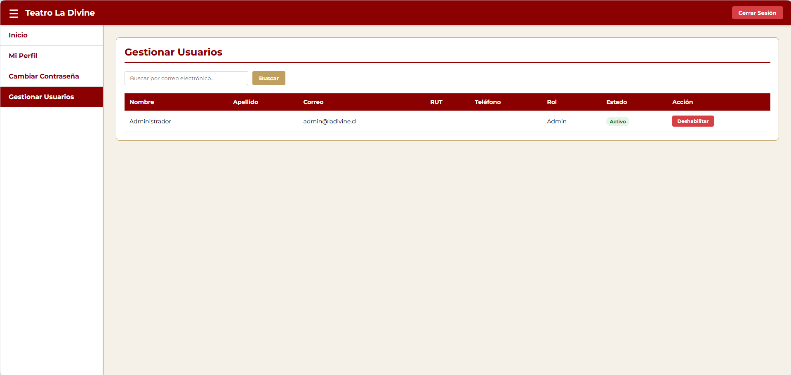

# 🎭 Frontend - Sistema Web Teatro La Divine

## 📌 Descripción del proyecto

Interfaz de usuario (SPA) para el sistema de gestión del Teatro La Divine. Este módulo permite a los administradores iniciar sesión, gestionar cuentas y, a futuro, administrar la cartelera y reservas de entradas.

Proyecto desarrollado en el contexto de la asignatura **Ingeniería de Software**.

---

## ⚙️ Cómo ejecutar el proyecto

Para levantar este entorno en tu máquina local, sigue estos pasos:

1. Abre una terminal y posiciónate dentro de la carpeta frontend.
2. Instala las dependencias de Node.js ejecutando:
    npm install
3. Levanta el servidor de desarrollo de Vite con:
    npm run dev
4. Abre tu navegador en la ruta que te indique la consola (usualmente http://localhost:5173).

---

## 👑 Funcionalidades de Administrador (Iteración 1)

El sistema cuenta con un panel exclusivo para el rol de Administrador. Para acceder a él, el usuario debe haber iniciado sesión previamente. Las características implementadas son:

* **Gestión de Cuentas:** Visualización de todos los usuarios del sistema en una tabla dinámica.
* **Búsqueda por Correo:** Herramienta para buscar cuentas específicas. Si el correo no existe, el sistema advierte con el mensaje exacto solicitado en la ERS.
* **Habilitar y Deshabilitar:** Control total sobre quién puede acceder al sistema. Los usuarios deshabilitados rebotan en el Login.
* **Doble Confirmación:** Modal de seguridad (Double Check) diseñado para evitar que el administrador cambie el estado de un usuario por accidente.

---

## 🏗️ Tecnologías y Estructura

* **Librería principal:** React
* **Lenguaje:** TypeScript (.tsx)
* **Empaquetador:** Vite
* **Estilos:** CSS Puro (Módulos/Variables globales)

Estructura de carpetas:

    frontend/
    │
    ├── public/            # Assets estáticos y favicon
    ├── src/
    │   ├── components/    # Componentes reutilizables (Modales, Tablas, etc.)
    │   ├── assets/        # Imágenes y SVGs locales (ej: Logo)
    │   ├── styles/        # Archivos CSS globales
    │   ├── services/      # Consumo de la API del backend
    │   ├── App.tsx        # Enrutador principal y rutas protegidas
    │   ├── main.tsx       # Punto de entrada
    │   └── index.css      # Variables y estilos base
    └── package.json       # Dependencias y scripts

---

## 🎨 Estándares de interfaz (UI)

Se utilizan los colores definidos en los requerimientos para mantener la identidad del teatro:

* Primario: #8B0000
* Secundario: #C0A060
* Crítico: #D64045
* Advertencia: #E6C229
* Acento: #F5F0E8

Ejemplo de uso en CSS:

    :root {
      --primario: #8B0000;
      --secundario: #C0A060;
      --critico: #D64045;
    }

---

## 💻 Estándares de programación

### 🔹 Idioma
* **Código Fuente:** Estrictamente en **Inglés** (componentes, hooks, variables, rutas).
* **Documentación:** El README.md y comentarios en **Español**.

### 🔹 Nombres
* Componentes React e Interfaces TS: PascalCase
* Funciones, variables y estados: camelCase

---

## 🧪 Casos de prueba Frontend

| Caso | Entrada / Acción | Resultado esperado |
| :--- | :--- | :--- |
| Email inválido | Ingresar formato erróneo en Login | Borde rojo (#D64045) y mensaje de error |
| Búsqueda vacía | Buscar un correo que no existe en BD | Mensaje de error textual en color #f56558 |
| Deshabilitar | Clic en botón Deshabilitar en tabla | Apertura del Modal de confirmación |
| Redirección | Entrar a /dashboard sin iniciar sesión | Redirección forzada a /login |

---

## 👥 Integrantes

* Martín Alejandro Solari Garrido
* Daniel Antonio Días Vargas
* Gianny Alfredo Paredes Araya
* Juan José Gómez Vergara

---

## 📌 Estado del proyecto
✅ **Iteración 1 Finalizada** – Vistas integradas, validaciones aplicadas y consumiendo la API del backend.

---

## 🖼️ Vista Previa del Sistema

Aquí se puede observar el estado actual de la interfaz de administración y el funcionamiento del buscador por correo.

  
   
  <em>Figura 1: Iniciar sesión.</em>

  
   
  <em>Figura 2: Registrarse.</em>

  
   
  <em>Figura 3: Página principal del sistema.</em>

  
   
  <em>Figura 4: Vista de los atributos del usuario logeado.</em>

  
   
  <em>Figura 5: Sección donde el usuario logeado podrá cambiar su contraseña.</em>

  
   
  <em>Figura 6: Vista de una funcionalidad del administrador que permite habilitar o deshabilitar usuarios.</em>

---